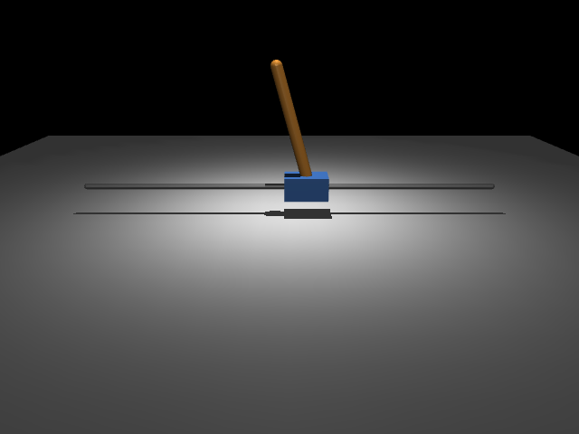
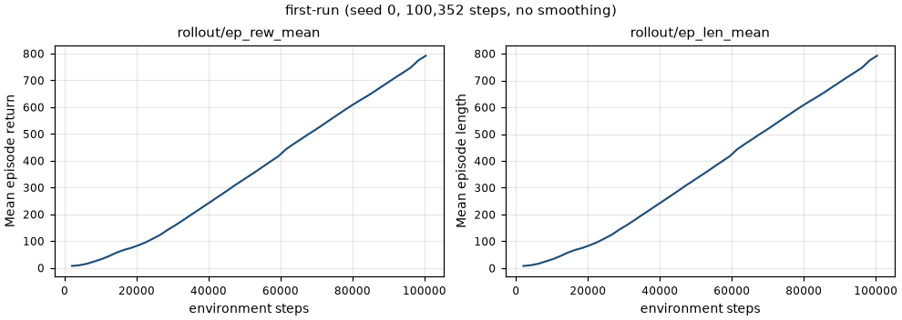

# CartPole report

Replace each **TODO** with your own observations. Keep this report short; link code,
compact results, and images instead of pasting logs.
For each stage, explain which tool or function uses your inputs, where the
results come from, and what uses them next. Point to the relevant code or
documentation; a few sentences or an annotated arrow diagram is enough.

To link a file in Markdown, use `[link text](relative/path/to/file)`.
For example, `[Environment code](../onboarding/env.py)` becomes
[Environment code](../onboarding/env.py). Links are relative to this report's
`docs/` folder; use `../` to reach the repository root.
To display an image, add `!`: ``.

## Setup

- Member: Daniel Gong
- OS: 15.6
- Setup diagnostic, viewer, and RGB results; any fix needed: Finished
- Fork URL and working branch: my fork is https://github.com/AlwaysDanielG/BSRA-RL and I worked on branch `onboarding/cartpole`. Upstream is https://github.com/kritav/BSRA-RL, which is the repository my fork was created from and whose `e05f7d7` my work builds on. The onboarding text names `grmpn/BSRA-RL`; `grmpn` is a contributor to the upstream repository (merged as PR #1) rather than its owner.
  Before starting, read the [toolchain overview](../resources/toolchain.md).
  What role does each of MuJoCo, Gymnasium, Stable-Baselines3, and TensorBoard
  play in this exercise? Describe how they work together in your own words: 

  MuJoCo is the physics engine. It loads the model files and figures out how the cart and pole actually move when a force is applied to the cart. Gymnasium sits on top of that and turns the simulation into a normal RL task, so it decides what the agent sees, what actions it can take, what reward it gets, and when an episode ends. Stable-Baselines3 is what does the learning. It talks to the Gymnasium environment, runs episodes over and over, and trains a PPO policy for me so I don't have to write the algorithm myself. TensorBoard just shows the numbers that SB3 logs while training, like reward over time, so I can see if things are improving and compare different runs.

  This is how they fit: SB3 picks an action, Gymnasium passes it into MuJoCo, MuJoCo steps the physics forward, and the new state comes back as an observation and a reward. That loop repeats thousands of times, and TensorBoard lets me look at what happened.

## Model and task

### Model (Stage 2)

- Which tool loads `scene.xml` and its included `cartpole.xml`, and what does it
  create from them? Point to the loading call in `scripts/view_model.py`. Which
  tool computes the motion you see in the viewer when a control is applied?

  MuJoCo does both. `mujoco.MjModel.from_xml_path` in
  [scripts/view_model.py](../scripts/view_model.py#L18) reads `scene.xml`, pulls
  `cartpole.xml` in at the `<include>`, and compiles the two files into one
  `MjModel`, which is the fixed description of the bodies, joints, geoms, and the
  motor. The changing state lives in a separate `MjData`. MuJoCo also computes the
  motion: the loop in [onboarding/viewer.py](../onboarding/viewer.py) writes the
  control into `data.ctrl` and calls `mujoco.mj_step`, which advances the physics
  by one `0.02 s` timestep, and the viewer just draws whatever that produced.

- Which XML file owns the mechanism, and how does the include connect it to the
  scene? Explain the slide/hinge axes, unactuated pole, box half-extents, and
  degrees versus radians. Link a small model screenshot (`../results/model.png`):

  [assets/cartpole.xml](../assets/cartpole.xml) owns the mechanism. It holds the
  `cart` and `pole` bodies and the `cart_motor` actuator inside a
  `<mujocoinclude>` root, so it is not a model on its own.
  [assets/scene.xml](../assets/scene.xml) is the top-level `<mujoco>` model, and
  its `<include file="cartpole.xml"/>` drops those contents in during compilation.
  The scene keeps the global settings and the scenery: compiler units, gravity,
  RK4, timestep, the floor, rail, light, and the `side` camera.

  The `slider` joint slides along `1 0 0`, so the cart moves in x, down the rail.
  The `hinge` rotates about `0 1 0`, so the pole falls in the x-z plane, the same
  plane the cart moves in. Only `slider` has a motor; the pole has no actuator, so
  it only moves from gravity and from being dragged by the cart. Box `size` values
  are half-extents, which is why `0.15 0.10 0.08` gives the `0.30 x 0.20 x 0.16 m`
  cart. The scene sets `angle="degree"`, so the hinge range is written as
  `-90 90` in the XML, but at runtime MuJoCo reports that joint in radians, and
  `qpos[1]` is limited to about `+/-1.5708`.

  

  The shot is the `side` camera after 25 steps at control `0.1`: the cart has slid
  along the rail and the pole has swung back about the hinge.

### Environment (Stage 3)

Answer each row in a few sentences, using the source linked in
[Stage 3](ONBOARDING.md#3-environment-setup-and-inspection). Name the function or
setting that supports your answer, and distinguish MuJoCo's role from Gymnasium's.

| Topic        | Question                                                                                                                                                | Your answer |
| ------------ | ------------------------------------------------------------------------------------------------------------------------------------------------------- | ----------- |
| Observations | What are the four values returned to the policy, in order and with units? Where do those values come from, and how does `_get_obs()` assemble them?     | Cart position (m), pole angle (rad), cart velocity (m/s), pole angular velocity (rad/s). They come straight from MuJoCo's simulation data: `_get_obs()` does `np.concatenate([self.data.qpos, self.data.qvel]).ravel()`, and my XML has two joints, so `qpos` and `qvel` are two elements each. The order follows the XML, `slider` first and `hinge` second. Gymnasium only copies the numbers out; MuJoCo is what computed them. |
| Actions      | What does the action control, what is its allowed range, and how does it reach the motor?                                                               | One value, the force pushing the cart along the rail. The range is `[-3, 3]`, which Gymnasium reads off the `ctrlrange` I set on `cart_motor` in [assets/cartpole.xml](../assets/cartpole.xml), not from anything in the Python. It reaches the motor in `_step_mujoco_simulation()`, which does `self.data.ctrl[:] = ctrl`. The `gear="100"` on the motor then scales it, so an action of 3 is not 3 N at the joint. |
| Physics      | Which tool computes motion from your XML model, and how does Gymnasium ask it to advance? How much simulated time passes per action?                    | MuJoCo computes the motion. `step()` calls `do_simulation(action, self.frame_skip)`, which passes it to `_step_mujoco_simulation()`, which calls `mujoco.mj_step(..., nstep=n_frames)`. That is the same `mj_step` the viewer used in Stage 2. With `timestep=0.02` from my scene and `FRAME_SKIP = 2`, each action covers `0.04 s` of simulated time (`dt = timestep * frame_skip`), so the policy acts at 25 Hz. |
| Reset        | What does `reset_model()` change at the start of an episode? How are the starting values randomized, and what does using the same reset seed reproduce? | It resets all four state values. It takes `init_qpos` and `init_qvel`, which are the zero/upright state from my XML, adds uniform noise in `[-0.01, 0.01]` (`RESET_NOISE` passed in as `reset_noise_scale`), and calls `set_state()`. The noise comes from `self.np_random`, so the same reset seed gives the exact same starting state every time, which is what makes the PPO-versus-random comparison in Stage 5 fair. |
| Reward       | What is the exact reward rule, which code computes it, and does it use the state before or after the action?                                            | `reward = int(not terminated)` in `step()`, so 1 for every step survived and 0 on the step that fails. It uses the state *after* the action: `step()` simulates first, then calls `_get_obs()`, then checks `terminated`. Failure is `abs(observation[1]) > 0.2` rad of pole angle, or a non-finite observation. Cart position never fails, and my XML's `[-1.25, 1.25]` slider limit only blocks the cart, it does not end the episode. |

- Environment test and random-rollout results; action-range warning:

  `uv run python -m pytest test/test_env.py` passes all 11 tests. Random rollouts
  (`scripts/evaluate.py --random-only --run-name random-debug --episodes 3`) gave a
  mean return of 4.67 and mean length 5.67 steps, with every episode ending on
  `terminated` and none hitting the time limit, so random pushing drops the pole in
  well under half a second. The `--video` run wrote
  `videos/random-debug/episode-10000.mp4` at 640 x 480, 25 fps, and my custom cart,
  pole, rail, and floor are visible through the `side` camera.

  SB3's env checker warns: `UserWarning: We recommend you to use a symmetric and
  normalized Box action space (range=[-1, 1])`. I am keeping `[-3, 3]` because the
  onboarding says to, and because the range comes from the motor's `ctrlrange` in
  my XML.

## Training

- Run name / source commit / training seed: `first-run` / `2d26581021817f18ee115c030d82140330928bd4` / seed `0`.
  `source_dirty` is `false`, so the run points at a clean, reproducible revision.
- Requested and actual steps / elapsed time / device: requested `100,000`, actual
  `100,352`, `19.8 s`, CPU with `torch_threads=1`. The extra 352 steps are because
  PPO only stops on a complete rollout, and `100,000` is not a multiple of
  `n_steps=2048`; 49 rollouts is `100,352`.
- Configuration and versions: [../results/first-run/run.json](../results/first-run/run.json).
  Default `PPO_SETTINGS` kept unchanged, so `learning_rate=3e-4`, `n_steps=2048`,
  `batch_size=64`, `n_epochs=10`, `gamma=0.99`, `gae_lambda=0.95`, `clip_range=0.2`,
  `stats_window_size=100`. Python 3.12.3, gymnasium 1.2.3, mujoco 3.6.0,
  stable-baselines3 2.7.1, torch 2.10.0, numpy 2.4.2.
- Learning curve:

  

- What do SB3, PyTorch, and `Monitor` each do here? How does SB3 use the environment
  and settings you pass to PPO?

  SB3 is the RL algorithm. It runs the environment to collect rollouts of 2,048
  steps, computes the PPO loss, and updates the policy for `n_epochs=10` passes in
  minibatches of 64. PyTorch is underneath that: `MlpPolicy` is a PyTorch network,
  and PyTorch does the gradients and the optimizer step. I never touch either
  directly. `Monitor` is a wrapper sitting between SB3 and my env. It does not
  change the task; it just records the return and length of each finished episode
  so SB3 has something to log. Without it, `rollout/ep_rew_mean` would be empty.

  SB3 only needs my env to follow the Gymnasium API. It calls `reset()` and
  `step()` and reads `observation_space` and `action_space` to size the network, so
  the input layer is 4 wide and the output 1 wide because of my XML.

- What do the curve's axes, averaging, and smoothing mean, and what evidence of
  improvement, variability, or a plateau do you see?

  The x-axis is environment steps, not episodes, and each point is logged once per
  rollout, so there are 49 points. Each value is a rolling mean over the last 100
  training episodes (`stats_window_size=100`), which is already a kind of
  smoothing. I plotted the raw logged values with no extra smoothing.

  There is clear, steady improvement: `rollout/ep_rew_mean` goes from `7.3` at
  2,048 steps to `791.8` at 100,352. The climb is close to linear after about
  20,000 steps and shows no plateau. It is still rising at the end of the budget,
  which says the run stopped because it hit the step budget, not because learning
  finished. More steps would probably push it toward the 1,000 ceiling.
  `ep_len_mean` tracks `ep_rew_mean` almost exactly, which makes sense since reward
  is 1 per surviving step.

## Evaluation

Use reset seeds 10000–10019, deterministic PPO actions, and random action seeds
`reset seed + 20000`. Standard deviations describe episodes (`ddof=0`).

| Agent | Episodes | Return mean ± std | Length mean ± std | Time-limit fraction |
| --- | --- | --- | --- | --- |
| Random | 20 | 4.80 ± 2.66 | 5.80 ± 2.66 | 0.00 |
| PPO | 20 | 1000.00 ± 0.00 | 1000.00 ± 0.00 | 1.00 |

- Per-episode CSV and summary JSON:
  [episodes.csv](../results/first-run/episodes.csv) and
  [summary.json](../results/first-run/summary.json).
  PPO reached the 1,000-step time limit on all 20 seeds, so every PPO row is
  `truncated=True` and `terminated=False`, and the standard deviation is exactly 0.
  Random dropped the pole in under 6 steps on average and never once reached the
  time limit. That is a difference of about 208x in mean return.
- Predetermined PPO rollout (seed 10000): the pole stays upright for the whole
  1,000 steps (40 s of simulated time). I replayed that seed and logged the state:
  the pole angle never exceeds `0.0281 rad`, which is about 14% of the `0.2 rad`
  failure threshold, and the cart stays between `-0.015 m` and `+0.078 m`, nowhere
  near the `+/-1.25 m` rail limit. In the video the cart makes small corrections
  and drifts slowly right. The policy is not just avoiding failure, it is holding
  the pole close to vertical.
- Limitation or failure, and a specific diagnosis if learning was weak: learning
  was not weak, so the limitation is elsewhere. This is **one training seed**
  (seed 0). The `± 0.00` in the table measures 20 different starting states for
  that single policy; it says nothing about how often a rerun with a different
  training seed would do this well. PPO is known to vary a lot across training
  seeds, so I cannot claim this result is typical from one run. A second limitation
  is that the evaluation ceiling is the time limit itself: once a policy reaches
  1,000 every time, the metric is saturated and cannot distinguish a good policy
  from a better one.

- Why does this evaluation differ from a training curve, and what can one
  trained seed not establish? What carries over to humanoid soccer, and what is
  missing?

  The curve and this evaluation measure different things, which is why the curve
  ends at `791.8` while evaluation gives a clean `1000.0`. Three reasons: training
  episodes use **stochastic** actions sampled from the policy, while evaluation
  uses `deterministic=True`; the curve is a rolling average over the last 100
  training episodes, so it still carries weaker earlier episodes; and the policy
  kept improving during the final rollouts. Evaluation is also a fresh process with
  no learning, on seeds reserved for evaluation.

  One trained seed cannot establish that the method is reliable. It gives no
  confidence interval over training runs and no evidence about sensitivity to
  hyperparameters or initialization.

  What carries over: the whole toolchain and workflow. An XML model compiled by
  MuJoCo, a Gymnasium wrapper defining observation, action, reward and termination,
  PPO on top, a reserved set of evaluation seeds, and a baseline to compare
  against. The habit of recording versions, hashes, and the source revision in
  `run.json` is what makes a result checkable later.

  What is missing is most of the hard part. Collisions are disabled here with
  `contype="0" conaffinity="0"`, so there are no contacts at all, and contact is
  the core difficulty in walking or kicking. The observation is the full exact
  state, 4 clean numbers, rather than noisy or partial sensing. The action space is
  one actuator instead of many coupled joints. The reward is a trivial `+1` per
  step rather than a shaped objective. And nothing here touches sim-to-real
  transfer, where model error and latency start to matter.

## Review

Run everything from the repository root after `git clone` and `uv sync`.

```bash
# setup
uv run python scripts/check_setup.py
uv run mjpython scripts/check_setup.py --viewer     # mjpython only on macOS
uv run python scripts/check_setup.py --rgb

# tests
uv run python -m pytest

# model inspection (macOS: mjpython)
uv run mjpython scripts/view_model.py
uv run mjpython scripts/view_model.py --control 0.1 --seconds 1
uv run mjpython scripts/view_model.py --control -0.1 --seconds 1

# environment check with random actions
uv run python scripts/evaluate.py --random-only --run-name random-debug --episodes 3 --trace

# training (commit first, so run.json records a clean revision)
uv run python scripts/train.py --run-name smoke --smoke
uv run python scripts/train.py --run-name first-run --seed 0 --steps 100000
uv run tensorboard --logdir runs

# evaluation
uv run python scripts/evaluate.py --policy models/first-run/policy.zip --run-name first-run --video
```

No rendering environment variable was needed on Apple Silicon macOS. The only
platform requirement is launching anything that opens a viewer window with
`mjpython` instead of `python`, which MuJoCo needs for its passive viewer.
Training and evaluation use ordinary `python`.

Keep the saved policy, TensorBoard logs, and rollout video locally and share them
directly with the RL lead if requested. No file uploads, download links, or GitHub
release are required for these files.

- Automated test results: `uv run python -m pytest` passes **17 tests** (2 model,
  11 environment, 4 pipeline). The single warning is SB3's expected
  action-range notice, recorded in the Environment section above.
- Manual model/render/video checks:
  - Setup diagnostic, `--viewer`, and `--rgb` all passed during Stage 1.
  - Viewer trials ran at control `0`, `+0.1`, and `-0.1`. The cart moves in
    opposite directions for opposite controls and the pole swings about the hinge.
    Note: each trial crashes *after* the run finishes with
    `AssertionError: cannot join a dummy thread` from `thread.join()` in the
    supplied [onboarding/viewer.py](../onboarding/viewer.py). It happens in the
    teardown of the provided helper, not in my model, and the simulation loop
    completes first. Offscreen rendering is unaffected.
  - `results/model.png` was rendered offscreen through the `side` camera.
  - `videos/random-debug/episode-10000.mp4` shows the custom scene; random
    episodes end in about 5-6 steps.
  - `videos/first-run/episode-10000.mp4` is 1,000 frames at 25 fps, 640 x 480,
    and the pole stays upright throughout.
- Fork PR link and review notes (record merge in the PR): **TODO after pushing** --
  push `onboarding/cartpole` to `origin`
  (https://github.com/AlwaysDanielG/BSRA-RL), open the PR with base repository
  `AlwaysDanielG/BSRA-RL`, base branch `main`, compare branch
  `onboarding/cartpole`, then paste the PR link and merge note here.

## Feedback

- Did you learn anything from this onboarding? What was new, or what became
  clearer?

  The part that became clearest was the division of labour between the tools. I had thought of "the RL environment" as one thing, but tracing an action from `step()` through `do_simulation()` to `mj_step()` made the boundary obvious: Gymnasium does bookkeeping and MuJoCo does all the physics. Related to that, I had not expected how much of the task definition lives in the XML rather than in Python. The action range `[-3, 3]` comes from the motor's `ctrlrange` in my own file, and the observation is 4 wide only because I declared two joints.

  The reproducibility machinery was also new to me. `run.json` hashing the XML, `env.py`, and the lockfile, and recording the git revision and whether the tree was dirty, means a result can be checked later instead of just believed. The hash check that refuses to evaluate a policy against a changed task is a good example of making the honest path the easy one.

  Two things surprised me. The training curve ends at `791.8` while evaluation
  gives `1000.0`, and working out why (stochastic versus deterministic actions,
  plus a 100-episode rolling average) taught me more than the numbers themselves.
  And the result is nearly saturated: once the policy hits the time limit on every
  seed, the metric cannot distinguish good from better.

- What improvements would make the onboarding easier to follow or more useful?

  The supplied viewer crashes on teardown on Apple Silicon macOS
  (`AssertionError: cannot join a dummy thread`, [onboarding/viewer.py](../onboarding/viewer.py)).
  It is harmless, since it fires after the trial, but it looks like a failure at
  exactly the moment you are checking whether your model is correct. Either fix
  the `thread.join()` or warn about it in the Stage 2 text.

  Stage 2 asks for a screenshot at `results/model.png` but does not say how to
  capture one. The viewer window has no save button, so the practical route is
  offscreen rendering with `mujoco.Renderer`. One example line would save time.

  Stage 4 says to commit before the full run so `run.json` records a clean
  revision. Worth adding that `git status --porcelain` counts untracked files too,
  so leftover smoke-run output under `results/smoke/` keeps `source_dirty` true
  even after the code is committed.

  Finally, the exercise never produces a weak result to diagnose. The default
  settings work on the first try, so the instruction about supporting one
  diagnosis with checks and logs gets no exercise. A deliberately broken variant
  to debug would make that skill real rather than hypothetical.
